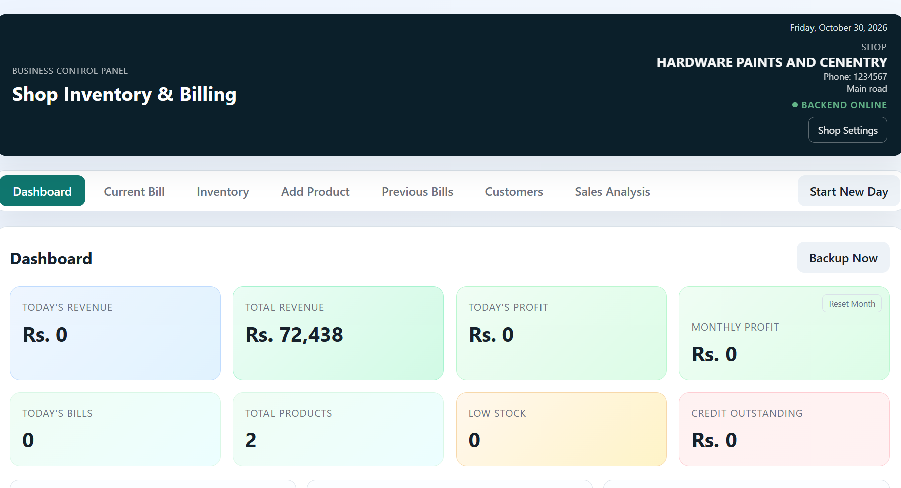
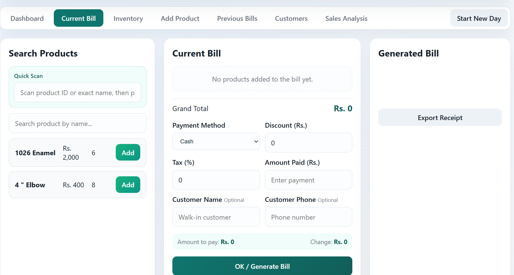

<div align="center">

# 🧾 Shop Inventory & Billing Management

**A lightweight, self-hosted web app for running a shop's billing counter and inventory — powered by a tiny C++ backend.**


</div>

---

A small C++ backend (`backend.exe`) stores all data in plain files next to the executable; the web page talks to it on `http://localhost:8080`.

## 📑 Table of Contents
- [Screenshots](#-screenshots)
- [Features](#-features)
- [Prerequisites](#-prerequisites)
- [Build the Backend](#-build-the-backend)
- [Run Locally](#-run-locally)
- [Designs](#-designs)
- [Security](#-security)
- [Data Files](#-data-files)
- [Source Files](#-source-files)
- [Contributing](#-contributing)
- [License](#-license)

## 📸 Screenshots
<!-- Add screenshots here, e.g.: -->
<!--  -->
<!--  -->
*(coming soon)*

## ✨ Features
- 📦 Add, update, and delete products (category, unit, purchase price, low-stock threshold)
- 🔍 Search products by name, or quick-scan by product ID / exact name (F2)
- 🧺 Add products to the current bill; repeated products are grouped into one row
- ➕ Quantity controls, discount, tax and change calculation
- 🖨️ Generate receipts with shop name, phone and address; print on 58mm / 80mm thermal printers
- 📉 Stock reduction after a completed sale
- 💾 Previous bills are saved in `sales.jsonl` and remain available after restarting the software
- 📊 Dashboard with revenue, profit, best sellers and low-stock alerts
- 🗂️ Automatic backups in the `backups` folder, plus a "Backup Now" button
- 📤 Export sales history as CSV

## ✅ Prerequisites
- **Windows** (the backend uses `ws2_32` for networking)
- **MinGW-w64 g++** (C++17) — only needed to build the backend from source
- **Python 3** — only needed to run the security test suite

> ℹ️ The compiled `backend.exe` is **not** included in this repo (binaries aren't versioned). You must build it once after cloning — see below.

## 🛠️ Build the Backend
```powershell
g++ -std=c++17 -O2 -o backend.exe backend.cpp -lws2_32 -static
```
This produces `backend.exe` in the project folder. Data files (`products.txt`, `shop_name.txt`, `sales.jsonl`) and the `backups/` folder are created automatically the first time it runs.

## 🚀 Run Locally
Double-click `run_shop.bat`, or start the backend yourself:

```powershell
.\backend.exe          # optional: .\backend.exe 8081 to use another port
```

Keep that terminal running and open **http://localhost:8080/** — the backend serves the web page itself.
(`python -m http.server 3000` and http://localhost:3000 also still work.)

> ⚠️ Opening `index.html` directly from the folder no longer works: the backend refuses pages it can't identify, so other websites can't reach your shop data.

## 🎨 Designs
Shop Settings → Design switches between three looks (remembered per browser):

| Theme | Description |
|---|---|
| **Classic** | The original design |
| **Counter** | Light workshop look: concrete, graphite and safety yellow (`themes/counter.css`) |
| **Fan deck** | Green side rail with paint-chip dashboard figures (`themes/fandeck.css`) |

You can also open a design directly: `http://localhost:8080/?design=counter` or `?design=fandeck`

## 🔒 Security
The backend:
- Only listens on this computer, only answers pages served from localhost (blocks CSRF / DNS-rebinding)
- Validates every field with a real JSON parser and size limits
- Cuts off slow or oversized requests
- Keeps the newest 50 backups per file
- Sends security headers (CSP, no-sniff, no framing)

Run the test suite against an isolated copy:

```powershell
python tests\security_test.py
```

## 🗄️ Data Files
| File | Contents |
|---|---|
| `products.txt` | Products, 8 lines per product (id, name, price, stock, category, unit, low-stock threshold, purchase price) |
| `sales.jsonl` | One saved bill per line |
| `shop_name.txt` | Shop name, phone and address |
| `backups/` | Timestamped copies made before every change |

## 📂 Source Files
| File | Purpose |
|---|---|
| `index.html` | App layout |
| `styles.css` | Interface styling |
| `script.js` | Frontend logic |
| `backend.cpp` | HTTP API, file storage and web page serving (uses `include/json.hpp`) |
| `themes/` | Alternative designs |
| `tests/security_test.py` | Security and robustness tests |

## 🤝 Contributing
Contributions are welcome!

1. Fork the repo and create a branch for your change
2. Keep changes focused — one feature or fix per pull request
3. If you touch `backend.cpp`, run the security test suite before opening a PR:
   ```powershell
   g++ -std=c++17 -O2 -o backend.exe backend.cpp -lws2_32 -static
   python tests\security_test.py
   ```
4. Describe what you changed and why in the PR description
5. Open an issue first for larger changes, so the approach can be discussed before you invest time in it

## 📄 License
This project is licensed under the [MIT License](LICENSE) — you're free to use, modify, and distribute it, including commercially, as long as the copyright notice is kept.

---

<div align="center">

Built and maintained by **[@dictators0987-dotcom](https://github.com/dictators0987-dotcom)**

⭐ If this project is useful to you, consider starring the repo!

</div>
